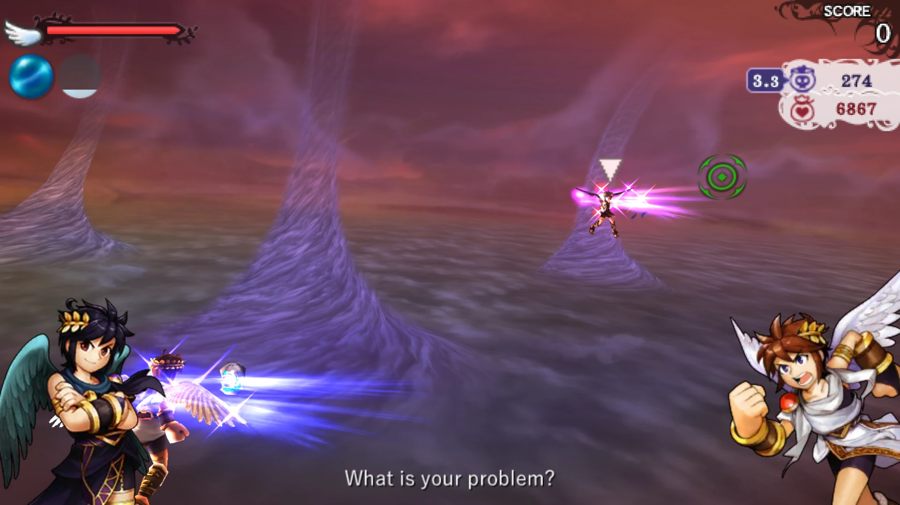
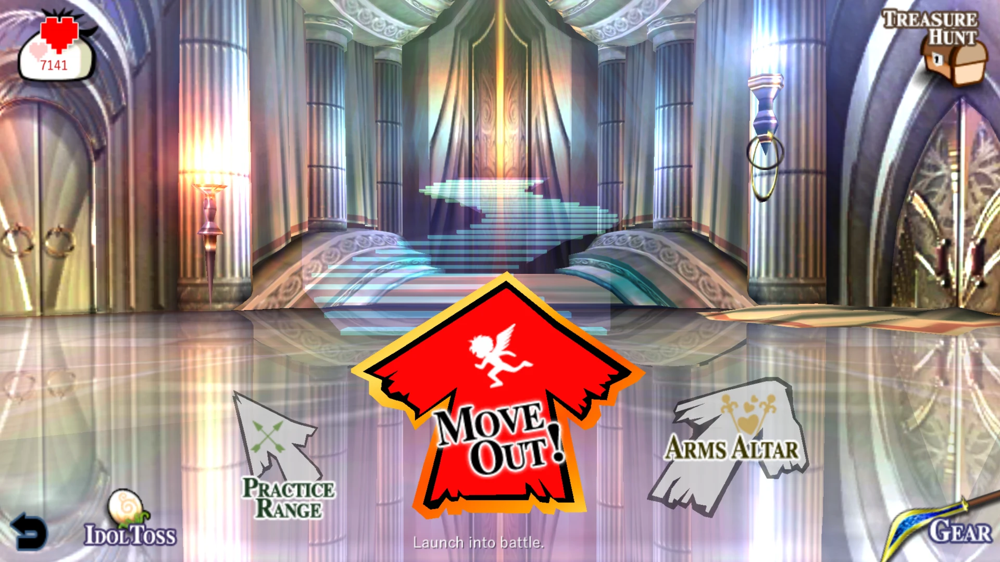
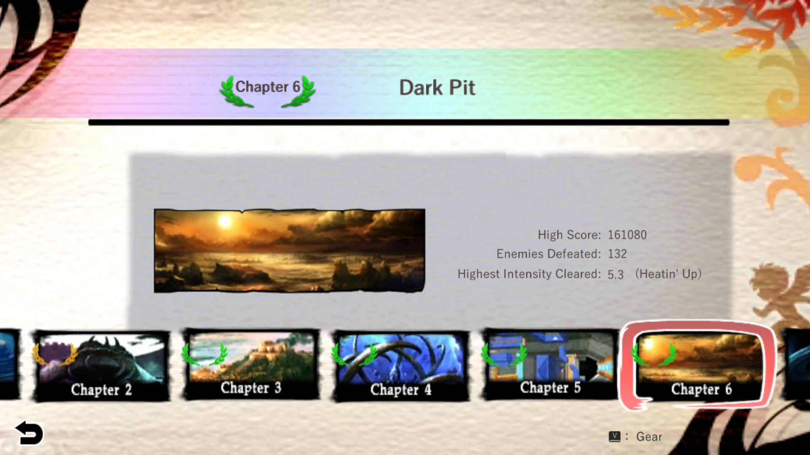
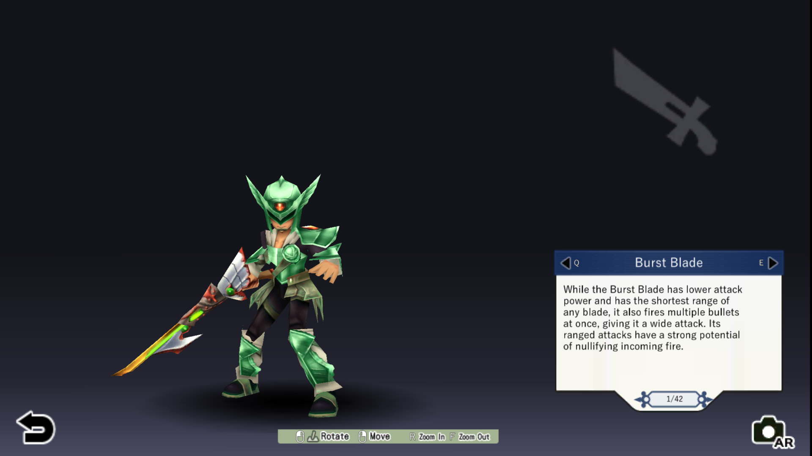
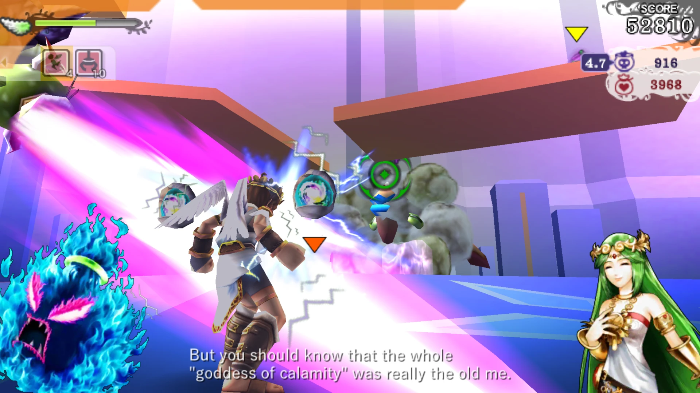

# Kid Icarus: Uprising — PC

A PC port of Kid Icarus: Uprising with mouse aim and a single-screen layout. Work in progress.

## Download

Get the latest build from the [nightly release](https://github.com/patricksmill/UprisingHack/releases/tag/nightly) (Windows and Linux). It is rebuilt from `main` each day and may be broken; [tagged releases](https://github.com/patricksmill/UprisingHack/releases) are more stable.

You need your own **decrypted** dump of Kid Icarus: Uprising (USA, 0004000000030100). No game data is included.

1. Unzip the archive and run `zakuro.exe` (Linux: `./zakuro`, which needs `libasound2`).
2. Press **Choose folder…** and pick the folder with your dump.
3. Press **Recompile** next to the game. It takes about ten minutes, and is needed again after each update. If you have no C compiler, Zakuro offers to download one.
4. Launch the game. Press **F12** (or **Home** on a controller) for the emulator menu.

To build from source instead, see [docs/BUILDING.md](docs/BUILDING.md).

Found a bug or want a change? [Open an issue](https://github.com/patricksmill/UprisingHack/issues/new/choose).

## Features

- Mouse aim: an absolute reticle in air battles and mouse-look on the ground.
- Rebindable keyboard, mouse and controller input, with optional gyro aim ([see below](#gyro-aim)).
- Menus work with the mouse, using the game's own cursor and confirm logic.
- The battle HUD, dialogue, pause menu and scripted menus are moved from the bottom screen onto the main view.
- Widescreen. 16:9 is recommended for menus; ultrawide works in battle.
- An optional 60 FPS patch ([how](docs/BUILDING.md#5-optional-the-60-fps-patch)).

<table>
  <tr>
    <td></td>
    <td></td>
  </tr>
  <tr>
    <td></td>
    <td></td>
  </tr>
  <tr>
    <td></td>
    <td></td>
  </tr>
</table>

### Original layout

Set any of these environment variables to `0` to show that part as the 3DS does:

| Variable | Part |
| --- | --- |
| `ZAKURO_MENUS_TOP` | Scripted menus |
| `ZAKURO_NARRATION_TOP` | Dialogue and narration |
| `ZAKURO_PAUSE_TOP` | Pause menu |
| `ZAKURO_CAULDRON_TOP` | Fiend's Cauldron |
| `ZAKURO_MIRROR_BOTTOM` | Bottom-screen mirroring |
| `ZAKURO_MENU_HOVER` | Mouse hover in menus |

### Gyro aim

The port passes a controller's gyroscope to the game, but the game only aims with it once Darkshade's **Kid Icarus: Uprising C-Stick & Gyro Patch** is installed (not included). This is experimental and untested. Install only its Base Patch, not its widescreen option, and recompile afterwards. It replaces `code.bin`, so it can't be combined with the 60 FPS patch.

## How it works

The game's ARM code is recompiled ahead of time into native code by [3dsrecomp](https://github.com/patricksmill/3dsrecomp), and runs on a fork of the [Zakuro](https://github.com/fearkov/zakuro) runtime. A few game functions are replaced or hooked for the PC changes; the rest is the original game logic.

Port-specific code lives in `kiu/` and `crates/zakuro-core/src/aim_mouse/`. See [PLAN.md](PLAN.md) for the roadmap and [GLOSSARY.md](GLOSSARY.md) for terms.

## Credits

- [fearkov](https://github.com/fearkov), for [Zakuro](https://github.com/fearkov/zakuro) and [3dsrecomp](https://github.com/fearkov/3dsrecomp).
- Darkshade, for the C-Stick & Gyro Patch, whose widescreen hooks helped map the projection, HUD and reticle code.

## License

[GPL-3.0-or-later](LICENSE). Zakuro and 3dsrecomp code by fearkov remains under the [MIT license](LICENSE-MIT).

Not affiliated with or endorsed by Nintendo, Project Sora or Sora Ltd. Kid Icarus is a trademark of Nintendo.

