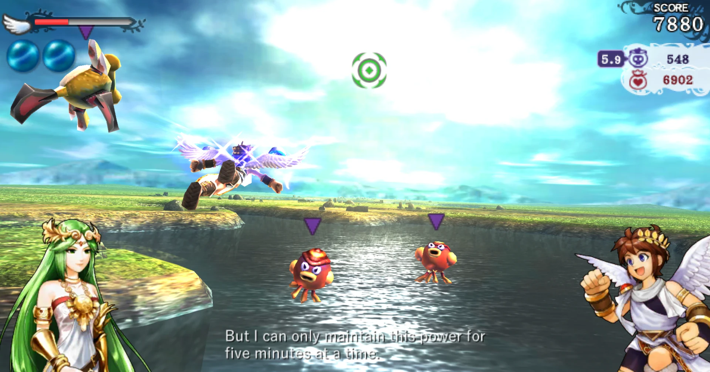
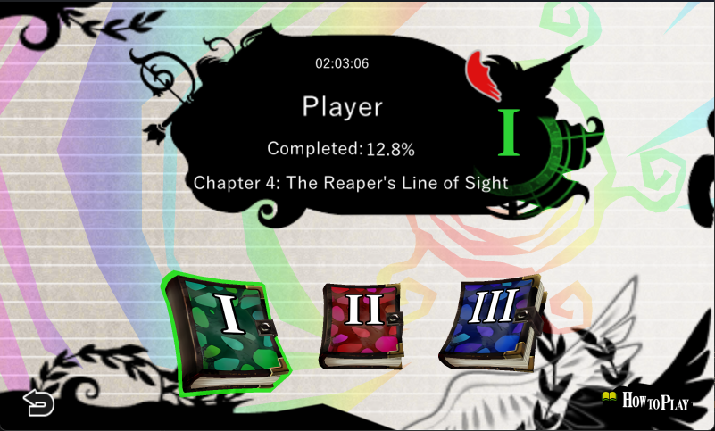

<div align="center">

<!-- LOGO PLACEHOLDER: replace with docs/images/logo.png (recommended ~640px wide, transparent PNG) -->


# Kid Icarus: Uprising — PC

**A native-feeling PC port of Kid Icarus: Uprising, with real mouse aim and a single-screen layout.**

Statically recompiled with [3dsrecomp](https://github.com/patricksmill/3dsrecomp) · a fork of [Zakuro](https://github.com/fearkov/zakuro)


-blue)




</div>

---

## Features

### 🎯 Controls
- **True mouse aiming** — absolute reticle in air battles, relative mouse-look camera on the ground.
- **Fully rebindable** keyboard, mouse and controller input.
- **Optional gyro aim** for supported controllers (experimental: needs [Darkshade's patch](#gyro-aim-and-darkshades-patch)).
- **Mouse-driven menus** — hover and click call the game's own cursor and confirm logic, so menus behave exactly as they would on hardware.

### 🖥️ One Screen
- **Battle HUD, dialogue, pause menu and scripted menus** relocated from the bottom screen onto the main view.
- **Widescreen** — 16:9 is recommended, since menu layouts are hand-placed for it; ultrawide is supported in battle.
- Every relocated Screen can be switched back to its original 3DS presentation individually.

### ⚡ Performance
- **Ahead-of-time recompiled** game code — no JIT warm-up, no interpreter.
- **60 FPS patch**, generated from your own `code.bin` by `kiu/scripts/make_60fps_ips.py` ([how](docs/BUILDING.md#5-optional-the-60-fps-patch)).
- Headless benchmark harness to track frame rate across upstream merges.

<!-- SCREENSHOT GRID PLACEHOLDERS: replace each with docs/images/<name>.png -->
<table>
  <tr>
    <td></td>
    <td></td>
  </tr>
  <tr>
    <td align="center"><sub>Ground battle with mouse-look</sub></td>
    <td align="center"><sub>Menus on one screen</sub></td>
  </tr>
  <tr>
    <td></td>
    <td></td>
  </tr>
  <tr>
    <td align="center"><sub>Ultrawide in battle</sub></td>
    <td align="center"><sub>Rebinding & PC settings</sub></td>
  </tr>
</table>

---

## How It Works

| Layer | Role |
| --- | --- |
| **3dsrecomp** | Translates the game's ARM `code.bin` into native code ahead of time. |
| **Overrides** | Small C replacements for selected game functions (`kiu/overrides/`, tracked in `docs/decomp/LEDGER.md`). |
| **Zakuro fork** | Runtime: GPU, audio, services, plus the PC frontend, input and screen-layout hooks. |
| **kiutrace** | Headless harness for save states, scripted input, screenshots and benchmarks. |

Only a handful of game functions are hooked; everything else runs as the original game logic.

---

## Getting Started

> [!IMPORTANT]
> You must provide your own **decrypted** dump of Kid Icarus: Uprising (USA). No game data is included or distributed.

### Prerequisites

- [Rust](https://rustup.rs) (stable) and a C compiler.
- **Linux:** `cmake`, `pkg-config`, and the ALSA and udev development files. On Debian, Ubuntu and Mint:
  ```sh
  sudo apt install build-essential cmake pkg-config libasound2-dev libudev-dev
  ```
- **Windows:** MinGW-w64 gcc (through MSYS2 or WinLibs) and CMake.

### Build

1. Clone the repository:
   ```sh
   git clone https://github.com/patricksmill/UprisingHack
   cd UprisingHack
   ```
2. Place your dump at `kiu/dumps/kiu.cci` (git ignores that folder).
3. Build and open the library:
   ```sh
   cargo run --release -p zakuro
   ```
   Cargo fetches the 3dsrecomp fork itself, at the commit `Cargo.lock` pins.
4. Press **Choose folder…**, pick `kiu/dumps/`, and press **Recompile** next to the game. Do this once, and again after each update. If Zakuro finds no C compiler, it offers to download one.
5. Launch the game from the library, or straight from the command line:
   ```sh
   cargo run --release -p zakuro -- kiu/dumps/kiu.cci
   ```
   Until you recompile, the game runs in the interpreter, which is much slower.
6. Press **F12** in-game for the emulator menu, or **Home** on a controller. On a controller, the d-pad or left stick moves around the menu and its windows, Confirm (A) presses, and Back (B) closes the window on top.

To update, `git pull`, rebuild, then recompile.

More detail, including the 60 FPS patch: [docs/BUILDING.md](docs/BUILDING.md).

### Restoring original presentation

Set any of these to `0` to show that feature as the 3DS draws it:

| Variable | Feature |
| --- | --- |
| `ZAKURO_MENUS_TOP` | Scripted menus on the top screen |
| `ZAKURO_NARRATION_TOP` | Dialogue / narration |
| `ZAKURO_PAUSE_TOP` | Pause menu |
| `ZAKURO_CAULDRON_TOP` | Fiend's Cauldron |
| `ZAKURO_MIRROR_BOTTOM` | Bottom-screen mirroring |
| `ZAKURO_MENU_HOVER` | Mouse hover in menus |

---

## Repository Layout

This repository is a fork of [Zakuro](https://github.com/fearkov/zakuro). Upstream's code stays where it is; the port's own work sits in `kiu/`.

| Path | Contents |
| --- | --- |
| `crates/` | Zakuro, with the port's hooks (`zakuro-core/src/aim_mouse/`) and PC frontend (`zakuro/`) |
| `kiu/overrides/` | C overrides, embedded into Recompile |
| `kiu/tools/kiutrace` | Headless test & benchmark harness |
| `kiu/tools/funclist` | Function list export for Ghidra |
| `kiu/ghidra/` | Headless analysis scripts |
| `kiu/scripts/` | Benchmarks, IPS builder, image conversion |
| `kiu/analysis/` | `FINDINGS.md` (addresses), `PERFORMANCE.md` |
| `docs/` | Building, design decisions (`adr/`), decomp notes |
| `GLOSSARY.md` | Project terminology |

The recompiler is the [3dsrecomp fork](https://github.com/patricksmill/3dsrecomp), a Cargo dependency.

Roadmap and open issues: [`PLAN.md`](PLAN.md).

---

## Gyro aim and Darkshade's patch

The port reads a controller's gyroscope into the console's, but the game only aims with it once Darkshade's **Kid Icarus: Uprising C-Stick & Gyro Patch** is installed. That patch is not included here; get it from Darkshade's own release.

Combining it with the port is **experimental and not yet verified**:

- It replaces `code.bin` outright, so it cannot be combined with the [60 FPS patch](docs/BUILDING.md#5-optional-the-60-fps-patch), which is generated against the original.
- Install only its **Base Patch**. Skip its widescreen option: the port has its own.
- Recompile after installing it.

---

## Credits

- **[fearkov](https://github.com/fearkov)**, for [Zakuro](https://github.com/fearkov/zakuro), which this repository is a fork of, and [3dsrecomp](https://github.com/fearkov/3dsrecomp).
- **Darkshade**, for the Kid Icarus: Uprising C-Stick & Gyro Patch. Its widescreen hooks mapped the projection, HUD and reticle code the port's widescreen builds on.

## License

The port is licensed under the [GNU General Public License v3.0 or later](LICENSE). It is built on Zakuro and 3dsrecomp by fearkov, whose code remains available under the [MIT license](LICENSE-MIT); that notice is kept with it.

---

<div align="center">
<sub>Not affiliated with or endorsed by Nintendo, Project Sora or Sora Ltd. Kid Icarus is a trademark of Nintendo.</sub>
</div>
